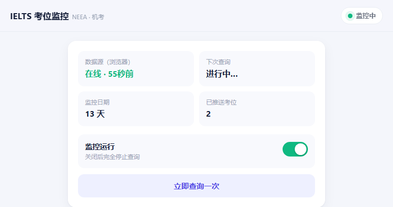
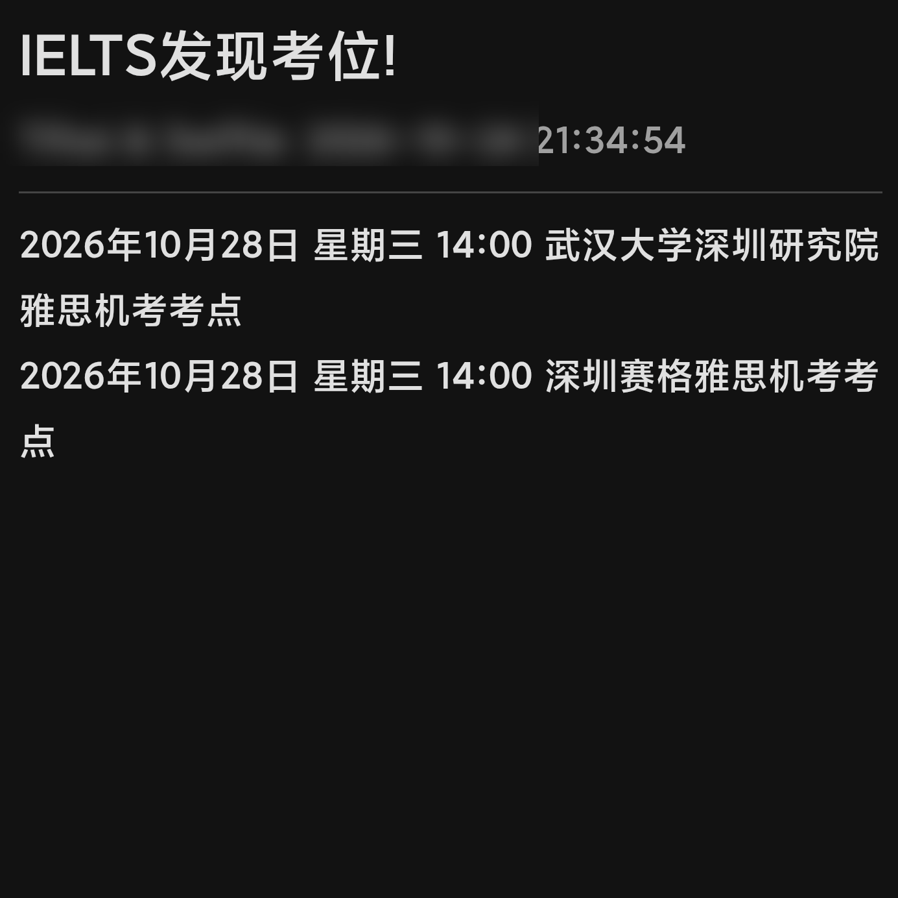
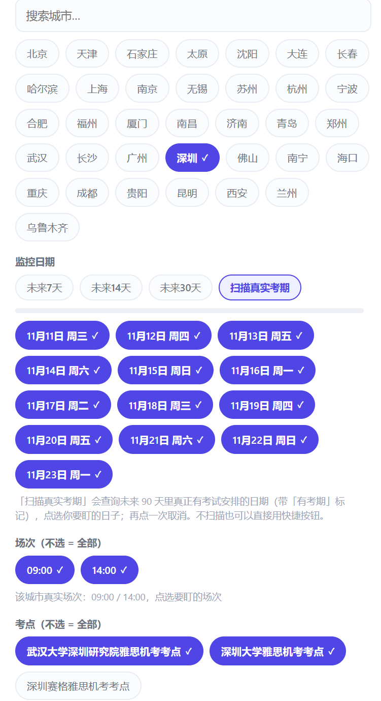
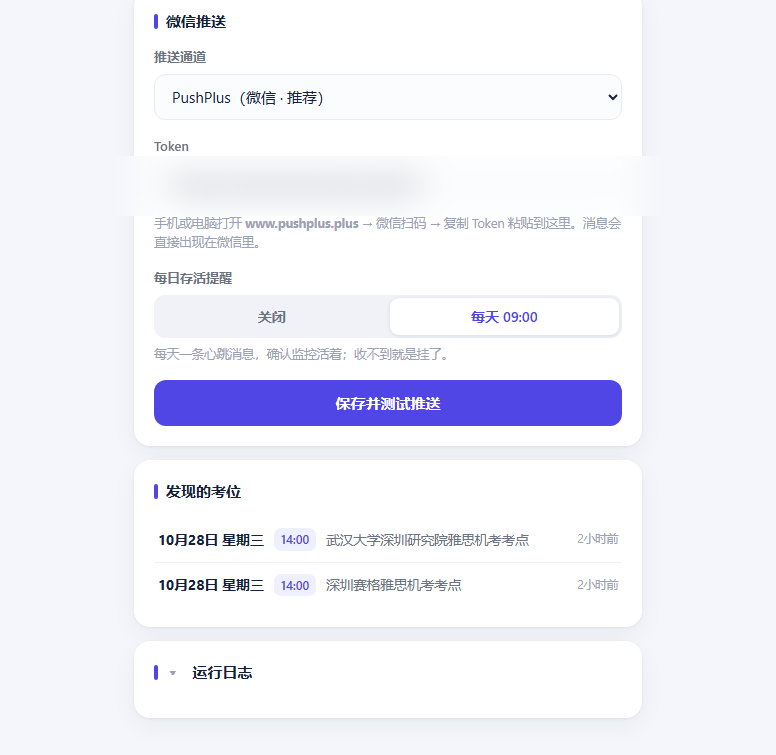
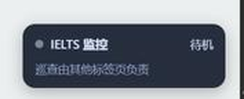

# IELTS Seat Watchdog

Self-hosted seat monitor for NEEA IELTS (mainland China). Your own Chrome tab does the seat polling, a small Docker control plane filters, deduplicates and pushes to WeChat the moment a seat opens.

[中文说明](README.zh-CN.md)

| Control panel | WeChat push on your phone |
| --- | --- |
|  |  |

| Configure dates / sessions / centers | Push setup + seats found (token redacted) |
| --- | --- |
|  |  |

## Why this architecture

ielts.neea.cn rejects every non-browser HTTP client (412), and even automation browsers cannot get its AJAX through. The one channel that always works is **your own logged-in Chrome tab**. So instead of fighting that, this project splits the job:

```
┌─────────────────────────────┐        ┌──────────────────────────────┐
│  Chrome + userscript (eye)  │  HTTP  │  Control-plane container     │
│  - polls queryTestSeats     │ ─────► │  (:9899, Flask)              │
│    with the page's own jQuery        │  - config store + web panel  │
│  - reports seats / centers  │ ◄───── │  - session/center filtering  │
│  - auto re-login (OCR)      │  tasks │  - dedup (seatId + 24h)      │
└─────────────────────────────┘        │  - WeChat push + heartbeat   │
                                       └──────────┬───────────────────┘
┌─────────────────────────────┐                   │
│  OCR sidecar container      │ ◄─ captcha ───────┘ (internal network)
│  (:9898, ddddocr)           │
└─────────────────────────────┘
```

- **Eye (userscript)**: runs in your real browser on ielts.neea.cn, queries seats exactly like the site itself does, and asks the control plane what to check next. Because it is your real session, the site sees a normal user.
- **Brain (control plane)**: everything configurable lives in a tap-friendly web panel at `http://127.0.0.1:9899` — cities, dates, sessions, centers, push channel. Saved settings hot-reload; the script picks them up on its next tick.
- **Captcha sidecar (optional)**: when the session expires, the script grabs the login captcha, sends it to a tiny `ddddocr` container, and logs back in by itself.

The result: closed-source-grade "app" experience with zero cloud and zero third party seeing your credentials.

## Features

- **Tap-to-configure panel** — 34 cities, real exam dates discovered by a 90-day scan, sessions (09:00 / 14:00) and centers auto-populated from live responses. No YAML editing for daily use.
- **Multi-city × multi-date × session/center filters** — e.g. Shenzhen + 13 dates + both sessions + 2 preferred centers, all from checkboxes.
- **WeChat push in seconds** — pushplus, ServerChan, Bark, WeCom webhook, DingTalk, Feishu or any custom HTTP endpoint. Duplicate seats are suppressed for 24 h.
- **Conservative polling** — 60 s ± 30 s random jitter (30 s floor enforced by the control plane), night pause 01:00–07:00 slows to 10 min, login failures capped at 3 before a 30 min cooldown. Read-only endpoint only; registration is never automated.
- **Survives reboots** — containers `restart: unless-stopped`; reopening the NEEA tab resumes polling and re-login automatically. Multi-tab lock keeps exactly one worker per browser.
- **Daily heartbeat** — one push at 09:00 proves the pipeline is alive; the panel flags "data source offline" if the worker stops reporting for 5 minutes.

## Quick start (Docker, recommended)

Prerequisites: Docker Desktop, Chrome + Tampermonkey, a logged-in [ielts.neea.cn](https://ielts.neea.cn) account.

```bash
git clone https://github.com/swiftiejerry/ielts-seat-watchdog.git
cd ielts-seat-watchdog
cp config.example.yml config.yml      # Windows: copy config.example.yml config.yml
# edit config.yml: fill neea.user_id / neea.password (only needed for auto re-login)
docker compose up -d --build
```

Then:

1. Install the userscript into Tampermonkey: [userscript/ielts-seat-watchdog.user.js](userscript/ielts-seat-watchdog.user.js) (Tampermonkey → Utilities → Import from file, or create from the raw URL).
2. Open https://ielts.neea.cn and log in. The script shows a small badge at the bottom-right corner (green = polling, amber = re-login, grey = standby).
3. Open the control panel: <http://127.0.0.1:9899> — pick cities, dates, sessions, centers and your push channel, hit **保存并测试推送**.

A WeChat message arrives the moment a seat in your filter opens. The worker also pins a small badge to the NEEA tab — green = polling, amber = re-login, grey = standby:



> Windows + Docker Desktop: enable *Settings → General → Start Docker Desktop when you sign in* so the monitor survives reboots. In Chrome, enable *On startup → Continue where you left off* so the NEEA tab comes back after a restart.

## Running without Docker

```bash
python -m pip install flask pyyaml tzdata ddddocr pillow flask-cors
# terminal 1 (optional, only for auto re-login)
python ocr_server.py                  # listens on :9898
# terminal 2 (control plane)
MONITOR_CONFIG=/path/to/config.yml MONITOR_DATA=/path/to/data python monitor/ielts_monitor.py
```

Set `ocr.url` accordingly (`http://127.0.0.1:9898` when not containerized).

## Configuration

Daily changes belong in the web panel; `config.yml` only seeds the first run.

| Key | Default | Meaning |
| --- | --- | --- |
| `neea.user_id` / `neea.password` | empty | NEEA credentials, used only by the userscript for auto re-login. Stays on your machine. |
| `monitor.product_code` | `IELTSCDI` | `IELTSCDI` = computer-delivered, `IELTSPBT` = paper-based |
| `monitor.cities` | `["440300"]` | city codes from the panel (440300 = Shenzhen) |
| `monitor.dates` | `[]` | `YYYY-MM-DD` list; the panel's 7/14/30-day buttons fill this |
| `monitor.center_keywords` / `session_keywords` | empty | substring filters; empty = accept all |
| `monitor.interval_seconds` / `jitter_seconds` | 60 / 30 | polling cadence; control plane enforces ≥ 30 s |
| `monitor.night_pause` | 01:00–07:00 → 600 s | off-hours slow-down |
| `push.provider` / `push.token` | pushplus / empty | see channels below |
| `push.heartbeat_time` | `09:00` | daily "still alive" push |

Push channels: `pushplus`, `serverchan`, `bark`, `wecom-hook`, `dingtalk`, `feishu`, `custom` (POST `{title, message}` JSON to any URL you paste as token).

## Fair-use & risk notes

- The worker only calls the **read-only** seat query endpoint, at a randomized human-like cadence far below what a person clicking around would produce. It never automates registration or payment.
- Keep the defaults. The control plane refuses intervals under 30 s on purpose.
- This is a personal-use tool. You are responsible for complying with the site's terms of service. Not affiliated with NEEA or the British Council.

## Tests

```bash
python tests/test_offline.py   # 28 offline checks: seat parsing, date expansion,
                               # night window, push builders, config merge
```

## Project layout

```
userscript/ielts-seat-watchdog.user.js   eye — Tampermonkey worker script
monitor/ielts_monitor.py                 brain — Flask control plane
monitor/ui.html                          web panel (single file, no build step)
ocr_server.py + Dockerfile               ddddocr captcha sidecar
docker-compose.yml                       one command brings up all three
tests/test_offline.py                    offline unit checks
config.example.yml                       seed config template
```

## Credits

The userscript is built on [ielts-auto-booking](https://github.com/SkyBlue997/ielts-auto-booking) by SkyBlue997 (MIT) — login flow and polling foundations retained, reworked into worker mode with the control-plane protocol. Thanks to [ielts.cn_hkj](https://github.com/mydansun/ielts.cn_hkj) for prior art in this space.

## License

[MIT](LICENSE)
